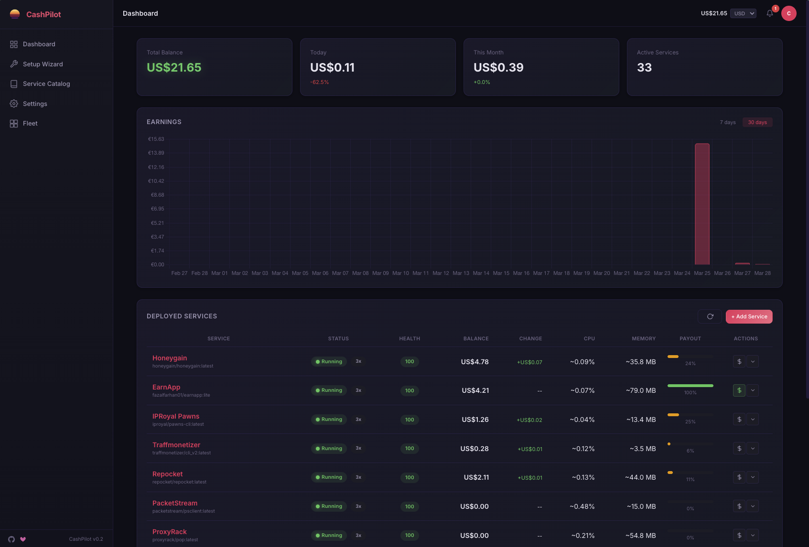

<p align="center">
  
</p>

<p align="center">
  <a href="https://hub.docker.com/r/aigetfree/incomeforge"></a>
  <a href="https://github.com/aigetfree/IncomeForge/stargazers"></a>
  <a href="LICENSE"></a>
  <a href="https://github.com/aigetfree/IncomeForge/actions/workflows/test.yml"></a>
  <a href="https://codecov.io/gh/aigetfree/IncomeForge"></a>
</p>

---

## What is IncomeForge?

IncomeForge is a self-hosted platform that lets you deploy, manage, and monitor passive income services from a single web interface. Instead of manually setting up dozens of Docker containers, configuring credentials, and checking multiple dashboards, IncomeForge handles everything from one place.

It supports both **Docker-based services** (deployed and managed automatically) and **browser extension / desktop-only services** (tracked via the web UI with signup links, earning estimates, and balance monitoring). Whether a service runs in a container or in your browser, IncomeForge aggregates all your earnings into a unified dashboard with historical tracking.

The key differentiator: a browser-based setup wizard guides you through account creation and service deployment, orchestrates containers through Docker workers, and collects earnings from 40+ services across bandwidth sharing, DePIN, storage, and GPU compute categories.



## Features

- **Web-based setup wizard** with guided account creation for each service
- **One-click container deployment** for 16+ passive income services
- **Real-time earnings dashboard** with historical charts and trend analysis
- **Container health monitoring** -- CPU, memory, network, and uptime at a glance
- **Multi-category support** -- bandwidth sharing, DePIN, storage sharing, GPU compute
- **Automatic earnings collection** from service APIs and dashboards
- **Mobile-responsive dark UI** -- manage your fleet from any device
- **Simple two-container setup** -- UI + Worker, no dependencies to install
- **Service catalog** with earning estimates, requirements, and platform details

## Quick Start

With Docker Compose (recommended):

```bash
docker compose up -d
# Open http://localhost:8080
```

This starts two containers:

- **incomeforge-ui** -- Web dashboard, earnings collection, service catalog (port 8080)
- **incomeforge-worker** -- Docker agent that deploys and monitors service containers (port 8081, requires Docker socket)

Then open [http://localhost:8080](http://localhost:8080) and follow the setup wizard.

> **Note:** The worker container requires access to the Docker socket (`/var/run/docker.sock`) to deploy and manage service containers. Both containers are required for full functionality.

## Supported Services

### Docker-Deployable Services

Services IncomeForge can deploy and manage automatically via Docker.

| Service | Guide | Residential IP | VPS IP | Devices / Acct | Devices / IP | Payout |
|---------|-------|:-:|:-:|:-:|:-:|--------|
| [Anyone Protocol](https://anyone.io) | [Guide](docs/guides/anyone-protocol.md) | ✅ | ✅ | Unlimited | 1 | Crypto (ANYONE) |
| [Bitping](https://app.bitping.com) | [Guide](docs/guides/bitping.md) | ✅ | ✅ | Unlimited | 1 | Crypto (SOL) |
| [Earn.fm](https://earn.fm/ref/DANI9GP6) | [Guide](docs/guides/earnfm.md) | ✅ | ✅ | Unlimited | 1 | Crypto |
| [EarnApp](https://earnapp.com/i/TSMD9wSm) | [Guide](docs/guides/earnapp.md) | ✅ | ❌ | 15 | 1 | PayPal, Gift Cards, Wise |
| [Honeygain](https://join.honeygain.com/DANIE3C3A3) | [Guide](docs/guides/honeygain.md) | ✅ | ❌ | 10 | 1 | PayPal, Crypto |
| [IPRoyal Pawns](https://discoverpawns.eu/MAN1C) | [Guide](docs/guides/iproyal.md) | ✅ | ❌ | Unlimited | 1 | PayPal, Crypto, Bank Transfer |
| [MystNodes](https://mystnodes.co/?referral_code=KnbtQTdG3BOf4K3N4t0Mst59qpykGv3V1MJXpBk0) | [Guide](docs/guides/mysterium.md) | ✅ | ✅ | Unlimited | Unlimited | Crypto (MYST) |
| [PacketStream](https://packetstream.io/?psr=3mc3) | [Guide](docs/guides/packetstream.md) | ✅ | ❌ | Unlimited | 1 | PayPal |
| [Presearch](https://presearch.com/signup?rid=4872322) | [Guide](docs/guides/presearch.md) | ✅ | ✅ | Unlimited | 1 | Crypto (PRE) |
| [ProxyBase](https://peer.proxybase.org?referral=nXzS3c6iTO) | [Guide](docs/guides/proxybase.md) | ✅ | ❌ | Unlimited | 1 | Crypto |
| [ProxyLite](https://proxylite.ru/?r=V6EFTILF) | [Guide](docs/guides/proxylite.md) | ✅ | ✅ | Unlimited | 1 | Crypto, PayPal |
| [ProxyRack](https://peer.proxyrack.com/ref/ltfssraa8s35hnwt4icausgdgaixw2q96vddasys) | [Guide](docs/guides/proxyrack.md) | ✅ | ✅ | 500 | 1 | PayPal, Crypto |
| [Repocket](https://repocket.com/) | [Guide](docs/guides/repocket.md) | ✅ | ❌ | 5 | 2 | PayPal, Crypto |
| [Storj](https://www.storj.io/node) | [Guide](docs/guides/storj.md) | ✅ | ✅ | Unlimited | 1 \* | Crypto (STORJ) |
| [Traffmonetizer](https://traffmonetizer.com/?aff=2064472) | [Guide](docs/guides/traffmonetizer.md) | ✅ | ✅ \*\* | Unlimited | Unlimited | Crypto (USDT), PayPal |
| [URnetwork](https://ur.io/?referral_code=1Q3G19) | [Guide](docs/guides/urnetwork.md) | ✅ | ✅ | Unlimited | 1 | Crypto |

> \* Storj nodes on the same /24 subnet share data allocation, reducing per-node earnings.
>
> \*\* Traffmonetizer ToS requires residential IP, but VPS nodes are accepted in practice.

### Browser Extension / Desktop Only

These services have no Docker image. IncomeForge lists them in the catalog with signup links and earning estimates, but cannot deploy or monitor them.

| Service | Guide | Residential IP | VPS IP | Devices / Acct | Devices / IP | Payout | Status |
|---------|-------|:-:|:-:|:-:|:-:|--------|--------|
| [Bytelixir](https://bytelixir.com/r/4FWJWYHAX0V2) | [Guide](docs/guides/bytelixir.md) | ✅ | ❌ | Unlimited | 1 | Crypto | Active |
| [Dawn Internet](https://dawninternet.com/?code=2QLQV97F) | [Guide](docs/guides/dawn.md) | ✅ | ❌ | Unlimited | 1 | Crypto (DAWN) | Active |
| [Deeper Network](https://deeper.network) | [Guide](docs/guides/deeper-network.md) | ✅ | ❌ | Unlimited | 1 | Crypto (DPR) | Active |
| [Ebesucher](https://www.ebesucher.com/?ref=aigetfree) | [Guide](docs/guides/ebesucher.md) | ✅ | ✅ | Unlimited | 1 | PayPal | Active |
| [Gradient Network](https://app.gradient.network/signup?referralCode=YSKMY7) | [Guide](docs/guides/gradient.md) | ✅ | ❌ | Unlimited | 1 | Crypto (GRADIENT) | Active |
| [Grass](https://app.grass.io/register?referralCode=kn8FNEPnUr2tMqE) | [Guide](docs/guides/grass.md) | ✅ | ❌ | Unlimited | 1 | Crypto (GRASS) | Active |
| [Helium](https://helium.com) | [Guide](docs/guides/helium.md) | ✅ | ❌ | Unlimited | 1 | Crypto (HNT) | Active |
| [Nodepay](https://app.nodepay.ai/register?ref=0wzzyznen64j9zx) | [Guide](docs/guides/nodepay.md) | ✅ | ❌ | Unlimited | 1 | Crypto (NC) | Active |
| [Nodle](https://nodle.com) | [Guide](docs/guides/nodle.md) | ✅ | ✅ | Unlimited | 1 | Crypto (NODL) | Active |
| [PassiveApp](https://passiveapp.com/i/bqpC4M) | [Guide](docs/guides/passiveapp.md) | ✅ | ❌ | Unlimited | 1 | Crypto, PayPal | Active |
| [Sentinel dVPN](https://sentinel.co) | [Guide](docs/guides/sentinel-dvpn.md) | ✅ | ✅ | Unlimited | 1 | Crypto (DVPN) | Active |
| [Spide](https://spide.network/register.html?f3bc51) | [Guide](docs/guides/spide.md) | ✅ | ❌ | Unlimited | 1 | Crypto | Active |
| [Teneo Protocol](https://dashboard.teneo.pro/?code=CAqef) | [Guide](docs/guides/teneo.md) | ✅ | ❌ | Unlimited | 1 | Crypto (TENEO) | Active |
| [Theta Edge Node](https://thetatoken.org) | [Guide](docs/guides/theta-edge.md) | ✅ | ✅ | Unlimited | 1 | Crypto (TFUEL) | Active |
| [Titan Network](https://edge.titannet.info/signup?inviteCode=2GKKJ495) | [Guide](docs/guides/titan.md) | ✅ | ❌ | Unlimited | 1 | Crypto (TNT) | Active |
| [Uprock](https://link.uprock.com/i/33e8492e) | [Guide](docs/guides/uprock.md) | ✅ | ❌ | Unlimited | 1 | Crypto | Active |

### GPU Compute

GPU-intensive computing services. Requires compatible hardware.

| Service | Guide | Residential IP | GPU | Min Storage | Payout | Status |
|---------|-------|:-:|:-:|:-:|--------|--------|
| [Flux](https://runonflux.io) | [Guide](docs/guides/flux.md) | ✅ | ❌ | 220GB | Crypto (FLUX) | Active |
| [Golem Network](https://golem.network) | [Guide](docs/guides/golem.md) | ✅ | ❌ | 20GB | Crypto (GLM) | Active |
| [io.net](https://io.net) | [Guide](docs/guides/ionet.md) | ✅ | ✅ | N/A | Crypto (IO) | Active |
| [Nosana](https://nosana.io) | [Guide](docs/guides/nosana.md) | ✅ | ✅ | 50GB | Crypto (NOS) | Active |
| [Salad](https://salad.io) | [Guide](docs/guides/salad.md) | ✅ | ✅ | N/A | PayPal, Gift Cards | Active |
| [Vast.ai](https://cloud.vast.ai/?ref_id=452772) | [Guide](docs/guides/vast-ai.md) | ✅ | ✅ | 100GB | Crypto, Bank Transfer | Active |

> **Note:** Earnings vary widely by location, hardware, and demand -- see individual guide pages in `docs/guides/` for details.

## How It Works

1. **Deploy IncomeForge** -- a single `docker compose up -d` gets you running
2. **Open the web UI** -- browse the full service catalog at `http://localhost:8080`
3. **Browse services** -- filter by category, see earning estimates and requirements
4. **Sign up** -- each service card has a signup link; create accounts as needed
5. **Enter your credentials** -- the setup wizard collects only what each service needs
6. **IncomeForge deploys and monitors** -- the worker launches containers, health-checks them, and the UI tracks earnings automatically

## Architecture

IncomeForge uses a split UI + Worker architecture:

- **UI container** (`aigetfree/incomeforge`) -- FastAPI web application with dashboard, earnings collection, service catalog, and credential storage. No Docker socket needed.
- **Worker container** (`aigetfree/incomeforge-worker`) -- Agent with Docker socket access that deploys, monitors, and manages service containers. Reports status to the UI via API.
- **Database:** SQLite -- zero configuration, backed up via the mounted volume
- **Service definitions:** YAML files in `services/` are the single source of truth for all service metadata, Docker configuration, and earning estimates
- **Frontend:** Server-rendered templates with a responsive dark UI

```
incomeforge/
  app/            # FastAPI application (UI + worker API)
  services/       # YAML service definitions (source of truth)
    bandwidth/    # Bandwidth sharing services
    depin/        # DePIN services
    storage/      # Storage sharing services
    compute/      # GPU compute services
  docs/           # Documentation and guides
```

## Configuration

### UI Environment Variables

| Variable | Default | Description |
|----------|---------|-------------|
| `TZ` | `UTC` | Timezone for scheduling and display |
| `INCOMEFORGE_SECRET_KEY` | *(auto-generated)* | Encryption key for stored credentials |
| `INCOMEFORGE_API_KEY` | -- | Enrollment/bootstrap key; each worker then gets its own key (per-worker fleet keys, v1.0.0+) |
| `INCOMEFORGE_COLLECTION_INTERVAL` | `3600` | Seconds between earnings collection cycles |
| `INCOMEFORGE_PORT` | `8080` | Web UI port inside the container |
| `INCOMEFORGE_METRICS_ENABLED` | `false` | Set to `true` to expose Prometheus metrics at `/metrics` |

### Worker Environment Variables

| Variable | Default | Description |
|----------|---------|-------------|
| `TZ` | `UTC` | Timezone |
| `INCOMEFORGE_UI_URL` | -- | URL of the UI container, e.g. `http://incomeforge-ui:8080` |
| `INCOMEFORGE_API_KEY` | -- | Must match the UI's API key |
| `INCOMEFORGE_WORKER_NAME` | *(hostname)* | Display name for this worker in the fleet dashboard |

## Multi-Node Fleet Management

For power users running services across multiple servers, deploy a single IncomeForge UI and connect workers from each server. The UI aggregates everything into a unified fleet view; workers report via HTTP API.

```
IncomeForge UI (dashboard + earnings + catalog)
        ^                ^                ^
        | HTTP           | HTTP           | HTTP
  Worker (server-a)  Worker (server-b)  Worker (server-n)
  + Docker socket    + Docker socket    + Docker socket
```

### Setting up the fleet

Use `docker-compose.fleet.yml` on your main server to run both the UI and a local worker:

```bash
docker compose -f docker-compose.fleet.yml up -d
```

### Adding remote workers

On each additional server, deploy only a worker pointing to the UI:

```yaml
services:
  incomeforge-worker:
    image: aigetfree/incomeforge-worker:latest
    pull_policy: always
    container_name: incomeforge-worker
    ports:
      - "8081:8081"
    volumes:
      - /var/run/docker.sock:/var/run/docker.sock
      - incomeforge_worker_data:/data
    environment:
      - TZ=Europe/Madrid
      - INCOMEFORGE_UI_URL=http://main-server:8080
      - INCOMEFORGE_API_KEY=your-shared-api-key
      - INCOMEFORGE_WORKER_NAME=server-b
    restart: unless-stopped
    security_opt:
      - no-new-privileges:true

volumes:
  incomeforge_worker_data:
```

Workers connect outbound to the UI via HTTP -- no port forwarding needed on the worker side. The UI's fleet dashboard shows all connected workers, their containers, and live status. The UI can push commands (deploy, stop, restart) to any worker remotely.

## FAQ

**Is bandwidth sharing safe?**

Bandwidth sharing services generally route legitimate traffic (market research, ad verification, price comparison, content delivery) through your connection. That said, you are sharing your IP address, so review each service's terms of service and privacy policy carefully before signing up. Running these on a VPS rather than residential IP is an option for some services. **This is not legal advice -- consult with the particular services you intend to use and, if needed, seek independent legal counsel regarding your jurisdiction.**

**How much can I earn?**

Earnings vary widely based on location, ISP, number of devices, and which services you run. The dashboard tracks your actual earnings over time so you can optimize your setup.

**Can I run on a VPS or cloud server?**

Some services require a residential IP and will not pay (or will ban) VPS/datacenter IPs. These are marked as "Residential Only" in the service catalog. Services that work on VPS are a good way to scale up without additional home hardware.

**How are credentials stored?**

All service credentials are encrypted at rest in the SQLite database using your `INCOMEFORGE_SECRET_KEY`. The database file lives in the mounted Docker volume (`incomeforge_data:/data`). No credentials are ever sent anywhere except to the service containers themselves.

**What about security?**

Every service IncomeForge deploys runs inside its own isolated Docker container. Containers cannot access your host filesystem, other containers, or your local network unless explicitly configured to do so. IncomeForge further hardens deployments with `--security-opt no-new-privileges`, preventing privilege escalation inside containers. Service credentials are encrypted at rest using Fernet symmetric encryption. Only the worker container requires Docker socket access; the UI container has no privileged access.

That said, no setup is bulletproof. You are still running third-party software that routes external traffic through your network. Docker isolation significantly reduces the attack surface compared to running these services directly on your host, but it does not eliminate all risk. We recommend running IncomeForge on a dedicated machine or VLAN, keeping Docker and your host OS up to date, and reviewing the open-source code of any service before deploying it.

**What happens if a service container crashes?**

IncomeForge monitors container health continuously. If a service container exits unexpectedly, it is automatically restarted. The dashboard shows uptime and health status for every running service.

## Disclosure

> This project contains affiliate/referral links. If you sign up through these links, the project maintainer may earn a small commission at no extra cost to you. This helps support the development of IncomeForge. You are free to replace all referral codes with your own in the Settings page.

## Ecosystem

| Project | Type | Description |
|---------|------|-------------|
| [IncomeForge-android](https://github.com/aigetfree/IncomeForge-android) | Android Agent | Monitoring agent for passive income apps running on Android devices |
| [incomeforge-mcp](https://github.com/aigetfree/incomeforge-mcp) | MCP Server | Monitor earnings from AI assistants via the Model Context Protocol |
| [incomeforge-ha](https://github.com/aigetfree/incomeforge-ha) | Home Assistant Integration | Earnings and service status sensors for your smart home dashboard |
| [n8n-nodes-incomeforge](https://github.com/aigetfree/n8n-nodes-incomeforge) | n8n Community Node | Automate earnings workflows in n8n |

## Contributing

Contributions are welcome. To add a new service:

1. Create a YAML file in the appropriate `services/` subdirectory following `services/_schema.yml`
2. Add a guide page in `docs/guides/` for the service
3. Update the service tables in this README
4. Submit a pull request

For bug reports and feature requests, open an issue on GitHub.

## Discontinued / Broken Services

Services that were evaluated but are no longer listed in the catalog due to being dead, broken, or untrustworthy. Kept here for reference so they are not re-added.

| Service | Status | Reason | Last checked |
|---------|--------|--------|:------------:|
| SpeedShare | Dead | Project confirmed dead in Discord | Mar 2026 |
| Peer2Profit | Dead | Domain unreachable | Mar 2026 |
| PacketShare | Dead | Signup process broken, no progress | Mar 2026 |
| earn.cc | Broken | Server error on signup | Mar 2026 |
| WizardGain | Broken | Under maintenance indefinitely | Mar 2026 |
| Koii Network | Broken | Website says paused | Mar 2026 |
| Network3 | Broken | No SSL, no updates in months | Mar 2026 |
| GagaNode | Shady | Poorly made website, untrustworthy | Mar 2026 |
| BlockMesh (Perceptron) | Dropped | Rebranded, requires browser dev mode, shady | Mar 2026 |
| Bytebenefit | Dead | Domain sold/parked on marketplace | Mar 2026 |
| Wipter | Dead | Domain resolves to DNS sinkhole, infrastructure gone | Mar 2026 |
| Filecoin | Not viable | Enterprise-only (10 TiB min, datacenter infrastructure required) | Mar 2026 |
| AntGain | Dead | Telegram channel unavailable | Mar 2026 |

## How IncomeForge Compares

| Feature | IncomeForge | money4band | CashFactory | income-generator | InternetIncome |
|---------|:---------:|:----------:|:-----------:|:----------------:|:--------------:|
| Web UI with guided setup | **Yes** | No (CLI) | Partial (links only) | No (CLI) | No (CLI) |
| One-click container deploy | **Yes** | No (compose) | No (compose) | No | No (compose) |
| Earnings dashboard | **Yes** | No | No | No | No |
| Historical charts | **Yes** | No | No | No | No |
| Multi-node fleet management | **Yes** | No | No | No | No |
| Service catalog with guides | **49 services** | 17 | 8 | 14 | 8 |
| Automated earnings collection | **13 collectors** | 0 | 0 | 0 | 0 |
| Multi-arch (amd64 + arm64) | **Yes** | Yes | Yes | No | No |
| Credential encryption | **Yes** | No | No | No | No |
| Compose export | **Yes** | Yes | Yes | Yes | Yes |

## License

[GPL-3.0](LICENSE) -- Sergio Fernandez, 2026
