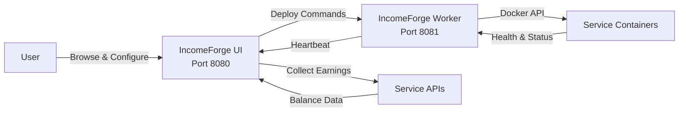

# Getting Started

## Prerequisites

- **Docker** and **Docker Compose** installed on your server
- A Linux, macOS, or Windows host (amd64 or arm64)
- At least 1 GB of RAM available for IncomeForge + managed services

## Quick Start

### 1. Clone and launch

```bash
git clone https://github.com/aigetfree/IncomeForge.git
cd IncomeForge
docker compose up -d
```

This starts two containers:

| Container | Port | Purpose |
|-----------|------|---------|
| **incomeforge-ui** | 8080 | Web dashboard, earnings collection, service catalog |
| **incomeforge-worker** | 8081 | Docker agent that deploys and monitors service containers |

### 2. Open the dashboard

Navigate to [http://localhost:8080](http://localhost:8080) in your browser. The onboarding wizard will guide you through initial setup.

### 3. Browse the service catalog

Filter services by category (bandwidth, DePIN, storage, compute), view earning estimates, and check requirements before deploying.

### 4. Sign up for services

Each service card has a signup link. Create accounts on the services you want to run.

### 5. Enter credentials and deploy

The setup wizard collects only the credentials each service needs (email/password, API token, etc.). Click **Deploy** and IncomeForge handles the rest -- pulling images, creating containers, and starting health monitoring.

## How It Works



1. **You configure** services through the web UI -- pick a service, enter credentials, click deploy.
2. **The UI sends** the container spec (image, env vars, volumes) to the worker via REST API.
3. **The worker creates** the Docker container and starts monitoring its health.
4. **The worker reports** container status back to the UI every 60 seconds via heartbeats.
5. **The UI collects** earnings from service APIs on a configurable schedule (default: every hour).
6. **The dashboard** shows aggregated earnings, per-service breakdowns, and container health.

## Configuration

### UI Environment Variables

| Variable | Default | Description |
|----------|---------|-------------|
| `TZ` | `UTC` | Timezone for scheduling and display |
| `INCOMEFORGE_SECRET_KEY` | *(auto-generated)* | Encryption key for stored credentials. Set this to persist encryption across container recreations |
| `INCOMEFORGE_API_KEY` | -- | Shared secret between UI and workers for API authentication |
| `INCOMEFORGE_COLLECTION_INTERVAL` | `3600` | Seconds between earnings collection cycles |
| `INCOMEFORGE_PORT` | `8080` | Web UI port inside the container |

### Worker Environment Variables

| Variable | Default | Description |
|----------|---------|-------------|
| `TZ` | `UTC` | Timezone |
| `INCOMEFORGE_UI_URL` | -- | URL of the UI container, e.g. `http://incomeforge-ui:8080` |
| `INCOMEFORGE_API_KEY` | -- | Must match the UI's API key |
| `INCOMEFORGE_WORKER_NAME` | *(hostname)* | Display name for this worker in the fleet dashboard |

### Docker Compose Example

```yaml
services:
  incomeforge-ui:
    image: aigetfree/incomeforge:latest
    pull_policy: always
    container_name: incomeforge-ui
    ports:
      - "8080:8080"
    volumes:
      - incomeforge_data:/data
    environment:
      - TZ=Europe/Madrid
      - INCOMEFORGE_API_KEY=your-secret-api-key
      - INCOMEFORGE_SECRET_KEY=your-encryption-key
    restart: unless-stopped

  incomeforge-worker:
    image: aigetfree/incomeforge-worker:latest
    pull_policy: always
    container_name: incomeforge-worker
    ports:
      - "8081:8081"
    volumes:
      - /var/run/docker.sock:/var/run/docker.sock
      - incomeforge_worker_data:/data
    environment:
      - TZ=Europe/Madrid
      - INCOMEFORGE_UI_URL=http://incomeforge-ui:8080
      - INCOMEFORGE_API_KEY=your-secret-api-key
    restart: unless-stopped
    security_opt:
      - no-new-privileges:true

volumes:
  incomeforge_data:
  incomeforge_worker_data:
```

!!! warning "Docker Socket Access"
    The worker container requires access to `/var/run/docker.sock` to manage service containers. This grants the worker significant privileges on the host. Run IncomeForge on a dedicated machine or VLAN for best security.

!!! tip "Secret Key Persistence"
    If you don't set `INCOMEFORGE_SECRET_KEY`, one is auto-generated on first run and stored in the data volume. If you recreate the volume, stored credentials become unreadable. Set an explicit key in your compose file to avoid this.

!!! tip "Passwords and secrets in the UI"
    Change your own password any time from the avatar menu -> **Change password** (available to all roles); this signs out your other sessions. In **Settings**, stored secrets are write-only: enter a value to change it, or leave the field blank to keep the existing one. Saved credentials are never sent back to the browser.

## Updating IncomeForge

The published images use floating tags, so updating is just a pull + recreate:

```bash
docker compose pull
docker compose up -d
```

`docker compose pull` fetches the newest published image and `up -d` recreates
only the containers whose image changed. The shipped compose files set
`pull_policy: always`, so even a bare `docker compose up -d` will pull the
latest image first.

!!! note "You do **not** need to rebuild"
    IncomeForge ships prebuilt multi-arch images on Docker Hub
    ([`aigetfree/incomeforge`](https://hub.docker.com/r/aigetfree/incomeforge),
    [`aigetfree/incomeforge-worker`](https://hub.docker.com/r/aigetfree/incomeforge-worker)).
    `docker compose build` / `--build` is only relevant if you deliberately
    build from source with `docker-compose.build.yml`. For normal installs,
    `pull` + `up -d` is the complete and correct update procedure.

### Pinning a specific version

`:latest` always tracks the newest release. To stay on a fixed version,
replace the tag (e.g. `aigetfree/incomeforge:0.6.13`) and remove
`pull_policy: always`. Browse available tags on
[Docker Hub](https://hub.docker.com/r/aigetfree/incomeforge/tags). The minor
tag (e.g. `:0.6`) tracks the latest patch within that minor series.

### Automating updates (optional)

If you want hands-off updates, point a scheduler at the same two commands —
for example a daily cron entry:

```cron
0 4 * * *  cd /path/to/incomeforge && docker compose pull && docker compose up -d
```

Or run an auto-updater such as [Watchtower](https://containrrr.dev/watchtower/)
or [Diun](https://crazymax.dev/diun/) against the IncomeForge containers. These
are entirely optional — IncomeForge does not bundle an updater.

## Supported Services

IncomeForge tracks **49 services** across four categories:

- **Bandwidth Sharing** (22 services) -- Share your internet bandwidth for passive income
- **DePIN** (20 services) -- Decentralized physical infrastructure networks
- **GPU Compute** (6 services) -- Rent out your GPU for AI and compute workloads
- **Storage** (1 service) -- Share disk space on decentralized storage networks

Of these, **16 services** can be deployed and managed automatically via Docker. The rest are browser extension or desktop-only services tracked in the catalog with signup links and earning estimates.

Browse the full catalog in the [Service Guides](guides/README.md) section.

## Next Steps

- [Architecture](architecture.md) -- Understand the UI + Worker split design
- [Fleet Management](fleet.md) -- Deploy across multiple servers
- [Service Guides](guides/README.md) -- Detailed setup instructions for each service
